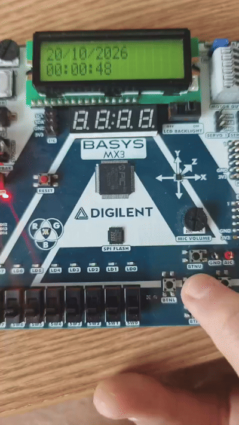

# PIC32 Digital Clock

A digital clock implementation built on a PIC32 microcontroller using **MPLAB X IDE** and written in **Embedded C**. The project focuses on hardware timer configurations, interrupt-driven architecture, and real-time display management.

## Hardware Demo
*Live demonstration of the PIC32 digital clock in operation:*  

## Tech Stack
- **Microcontroller:** PIC32 Family
- **IDE:** Microchip MPLAB X IDE
- **Language:** Embedded C

## Hardware Architecture & Features
- **Platform:** Digilent Basys MX3 development board powered by the **PIC32MX370F512L** microcontroller.
- **Interrupt-Driven Timekeeping:** Utilizes **Timer 1** hardware interrupts to maintain precise time counting (ticks and blinking logic) independently of screen latency.
- **PWM Audio Alarm:** Generates a buzzer alarm signal using **Timer 2** and **Output Compare 1 (OC1)** on pin RB14, featuring instant dismissal via hardware buttons.
- **Interactive State Machine (FSM):** Manages a multi-state menu system (Time, Date, and Alarm configurations) navigated via `BtnC`, `BtnL`, and `BtnR`, featuring *LongPress* rapid value increment/decrement.

### FSM State Diagram
*The logic flow detailing the transitions between normal operation and configuration states:*  

## How to Run
1. Open **Microchip MPLAB X IDE**.
2. Create or open the project workspace.
3. Connect your PIC32 programmer/debugger (e.g., MPLAB ICD 4 / PICKit) to the development board.
4. Build the project and flash the compiled hex file to the microcontroller.

## AI Usage
Artificial Intelligence tools were utilized during the development of this project to enhance workflow efficiency:
- **Debugging & Optimization:** Assisted in troubleshooting timer configurations, interrupt service routine (ISR) flags, and logic issues.
- **Code Structuring:** Helped organize modular code and handle low-level register definitions.
- **Documentation:** Structured and formatted the project documentation.
